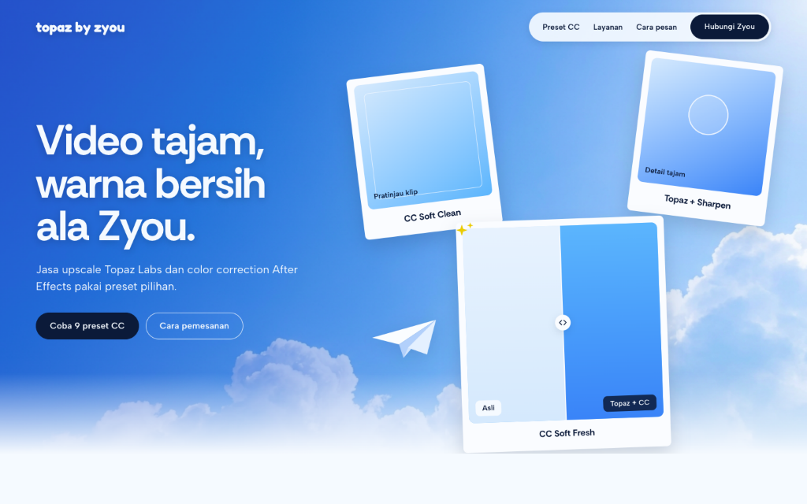

# Topaz by Zyou

Landing page jasa video enhancement **Topaz Labs** dan color correction **After Effects** dengan etalase video interaktif agar calon klien bisa menonton dan membandingkan klip **Original** dengan **18 Preset Pilihan** langsung dari hasil render After Effects dan Topaz asli.



## Fitur Utama

- **Etalase 18 Video Hasil Render AE & Topaz Asli:** Menampilkan **1 klip Original** (`original.mp4`) dan **18 klip Preset** (`CC BLUE BEATS` sampai `TOPAZ`) dengan tombol switch cepat Original vs Preset aktif.
- **Pemutar Tunggal Adaptif & Hemat Bandwidth:** Rasio aspek pemutar otomatis menyesuaikan video (`1:1`, `9:16`, `16:9`, atau campuran), auto-pause saat keluar viewport (`IntersectionObserver`), dan kartu grid tidak memuat banyak `<video>` sekaligus.
- **18 Kartu Preset Polaroid + Salin Order:** Pengunjung dapat memilih preset dari katalog, melihat durasi serta deskripsi preset, dan menyalin format pesan order siap kirim.
- **Siap Vercel CDN dan Cloudflare R2:** Mendukung hosting statis di `web/public/videos/` maupun env `VITE_VIDEO_BASE_URL` untuk memindahkan hosting video ke Cloudflare R2 tanpa mengubah kode.

## Menjalankan Secara Lokal

```bash
cd web
npm install
npm run dev
```

## Panduan Menambahkan Video & Optimasi Ukuran

Untuk panduan memasukkan `.mp4` hasil render After Effects, menjalankan kompresi opsional `npm run optimize:videos`, serta migrasi ke Cloudflare R2, baca [cara-upload-video-preset.md](./web/docs/cara-upload-video-preset.md).
